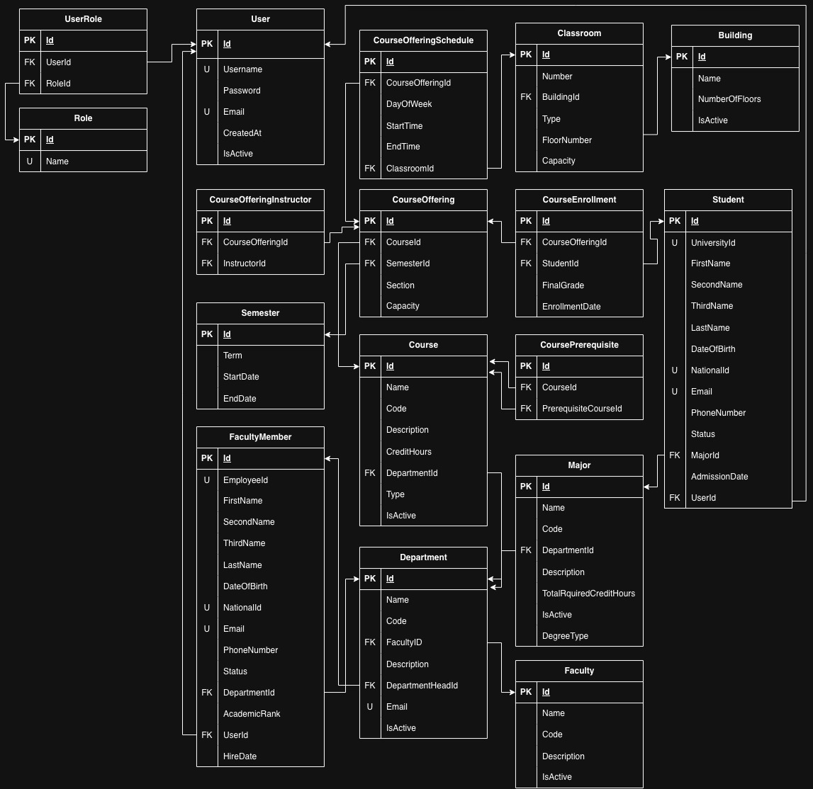
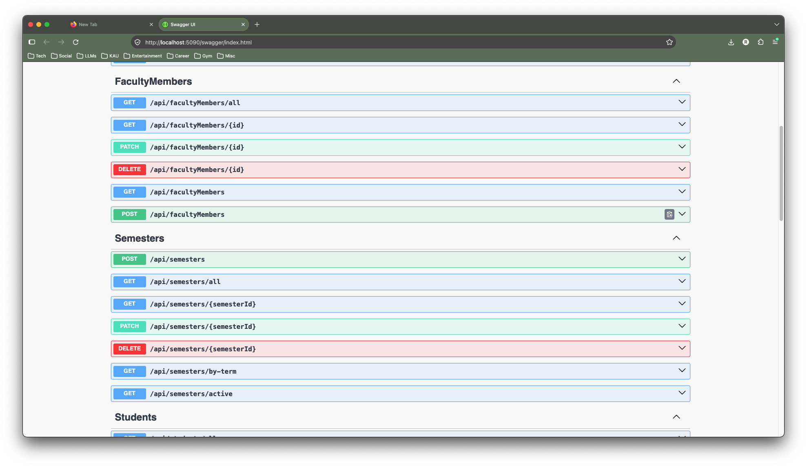
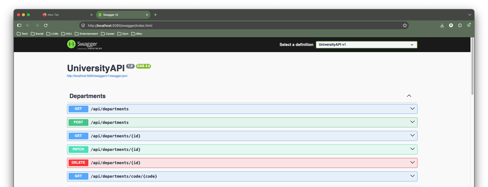

# University Management System

A university management system built with **ASP.NET Core 8 Web API**, **Entity Framework Core**, and **Microsoft SQL Server** to manage university operations, including students, faculty, departments, and academic records.

**Project Status:** In Progress

## 1. Tech Stack

- **Programming Language:** C#
- **Backend Framework:** ASP.NET Core 8 Web API
- **ORM:** Entity Framework Core 8
- **Database:** Microsoft SQL Server
- **API Documentation:** Swagger / OpenAPI
- **Architecture:** Layered Architecture

## 2. Implemented Features

The following functionality has been implemented:

- User management
- Student management
- Faculty Member management
- Department management
- Semester management
- RESTful API development with CRUD operations
- Request validation and business rule enforcement
- Pagination for supported endpoints
- Relational database management using Entity Framework Core

## 3. Planned Features

The following features are planned for future development:

- Course management
- Course registration and enrollment
- Grade management and GPA calculation
- Timetable management
- Announcements and notifications
- Administrative reports and dashboards

## 4. Architecture

The application follows a layered architecture to separate HTTP handling, business logic, and data access.

| Layer       | Responsibility                                          |
| ----------- | ------------------------------------------------------- |
| Controllers | Handle HTTP requests and responses.                     |
| Services    | Implement business logic and application operations.    |
| DTOs        | Define request and response data structures.            |
| Data Access | Manage database operations using Entity Framework Core. |
| Entities    | Represent database tables and relationships.            |

This separation helps improve code organization, maintainability, and testability.

## 5. Database Design

The system uses Microsoft SQL Server with Entity Framework Core for database operations and entity relationship management.

The database is designed around relational entities representing university resources and their relationships.

### Database Schema

## 6. API Endpoints

The API currently contains **30+ endpoints distributed across five controllers**, covering the implemented university management modules.

The endpoints support resource management through standard HTTP methods, including GET, POST, PUT, PATCH, and DELETE where applicable.

For the complete list of available endpoints, request parameters, and response schemas, refer to the Swagger documentation.

## 7. API Documentation

The project uses Swagger/OpenAPI to provide interactive API documentation and allow developers to explore and test available endpoints.

### Swagger UI

### API Examples

Additional screenshots demonstrating individual API operations can be found below.

